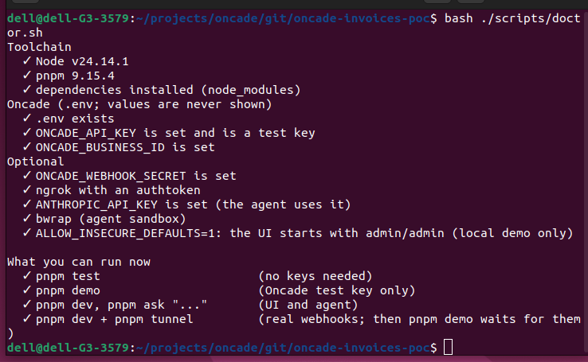

# Oncade invoices POC

A small TypeScript integration with the Oncade **test** environment, built with AI. One flow end
to end: **invoices**, including webhooks. Log in, ask a question in plain English ("Create a draft
invoice for Acme, 10 hours at $50", "Show my last 5 invoices"), and an agent answers by calling
the Oncade API through an MCP server, sandboxed. An **Allow changes** box (off by default) decides
whether it may create, send or cancel in that run.

## Start here

About five minutes, Linux or macOS, no LLM needed until step 4.

1. `./scripts/doctor.sh` checks Node 24+, pnpm 9, dependencies and `.env` (it never prints
   values) and says what you can run. `--fix` offers the safe local steps (corepack enable,
   `pnpm install`, `cp .env.example .env`), asking first. `pnpm run doctor` does the same
   (plain `pnpm doctor` is pnpm's own built-in command). On a machine with everything set up it
   looks like this (an earlier run; the ngrok check now also starts a short test tunnel):

   

2. `pnpm install && pnpm test`: no keys, no network.
3. `pnpm demo`: needs only `ONCADE_API_KEY` (`oncade_platform_test_...`) and `ONCADE_BUSINESS_ID`
   in `.env`. It creates a $1 draft for `demo@example.com` and sends it without email, creates a
   second draft and cancels it, reads both back and prints each id and status.
4. Optional, the UI and the agent: `pnpm dev` (see [Quick start](#quick-start)).
5. Optional, webhooks: [set them up](#webhooks), keep `pnpm dev` running, and `pnpm demo` waits up
   to 60 s for `Platform.Invoice.Created`, `Sent` and `Cancelled` of its own invoices.

### Check it yourself with curl

What `pnpm demo` does, against the same API (needs `jq`; macOS 15+ ships it):

```bash
API=https://www.oncade.gg/api/v1/platform
H=(-H "Authorization: Bearer $ONCADE_API_KEY" -H "X-Oncade-API-Version: v1"
   -H "X-Target-Business-Id: $ONCADE_BUSINESS_ID" -H "Content-Type: application/json")
key() { echo "Idempotency-Key: $(uuidgen | tr 'A-Z' 'a-z')"; }   # writes need a UUID
DRAFT=$(printf '{"receiverName":"curl demo","receiverEmail":"demo@example.com","date":"%s",
  "payToTarget":"BUSINESS","items":[{"description":"Demo item","quantity":1,"rate":1,"amount":1}]}' "$(date +%F)")

# 1. Create a draft and keep its _id
A=$(curl -sS "${H[@]}" -H "$(key)" -d "$DRAFT" "$API/invoices" | jq -r ._id); echo "draft $A"
# 2. Send it without email
curl -sS "${H[@]}" -H "$(key)" -d '{"sendEmail":false}' "$API/invoices/$A/send" | jq '{_id,status}'
# 3. A second draft, cancelled
B=$(curl -sS "${H[@]}" -H "$(key)" -d "$DRAFT" "$API/invoices" | jq -r ._id)
curl -sS "${H[@]}" -H "$(key)" -X POST "$API/invoices/$B/cancel" | jq '{_id,status}'
# 4. Read one back, then list the latest
curl -sS "${H[@]}" "$API/invoices/$A" | jq '{_id,invoiceNumber,status,total}'
curl -sS "${H[@]}" "$API/invoices?limit=5" | jq '[.invoices[] | {_id,status}]'
```

Export the two variables first (`export ONCADE_API_KEY=... ONCADE_BUSINESS_ID=...`). The demo
derives its Idempotency-Keys from the run and the request instead of `uuidgen`, so a retry within
a run cannot create a second invoice.


## Documentation

[docs/README.md](docs/README.md) is the index, with a five-minute reading order: architecture, security model, Oncade
API notes, then tests and evals, limitations and the production checklist, and operations. The current state and open
issues are in [STATUS.md](STATUS.md).

## Quick start

Requirements: Node 24+, pnpm 9, the Claude Code CLI (`claude`), optionally `bwrap` (Linux) and `ngrok`.

```bash
pnpm install
cp .env.example .env     # ONCADE_API_KEY (oncade_platform_test_...), ONCADE_BUSINESS_ID,
                         # and ANTHROPIC_API_KEY (or a logged-in Claude Code)
```

Local demo, admin / admin, with a loud warning:

```bash
ALLOW_INSECURE_DEFAULTS=1 pnpm dev      # UI on http://127.0.0.1:3000
```

The secure way: set `ADMIN_PASSWORD` (12+ characters) and `SESSION_SECRET` (`openssl rand -hex 32`)
in `.env`, then `pnpm dev`. Without them the server refuses to start. `GET /healthz` reports
whether Oncade and the `claude` CLI are reachable.

From the terminal: `pnpm ask "Show my last 5 invoices"` (read-only) or
`pnpm ask --allow-changes "Send invoice INV-2026-1234567"`. `pnpm runs` lists the last runs.

## Webhooks

1. `pnpm tunnel` (ngrok to the webhook port, 3001; the UI port is never exposed).
2. In dev.oncade.xyz, Platform Settings: webhook URL `https://<ngrok-host>/webhooks/oncade`.
3. Copy the webhook secret into `ONCADE_WEBHOOK_SECRET` in `.env` and restart `pnpm dev`.

## Checks

```bash
pnpm test           # 194 tests, no network, no secrets
pnpm lint           # ESLint (typescript-eslint); pnpm format:check for Prettier
pnpm typecheck      # TypeScript 7
pnpm eval           # 11 eval cases through the real agent (Sonnet, sandboxed), about $0.14
```

CI (GitHub Actions) runs install, lint, format check, typecheck and test on every push. Last
eval: 11/11 on prompt v3, $0.1419.

## How AI was used

The AI setup is in the repo: `AGENTS.md` holds the rules for any coding agent (commands,
MUST/SHOULD directives, verification and secrets rules, scope), `CLAUDE.md` points to it, and
`STATUS.md` keeps the current state for the next session.

Claude Code (Opus) wrote the code and did the research, with background subagents for
implementation chunks. Codex, a different model family, fact-checked the research. Code changes
were re-verified by independent verifier subagents (Claude Sonnet, fresh context) that re-applied
every claimed mutation and probed for bypasses. The in-app agent is Claude Code in headless mode on Sonnet. Nothing counted as done until it was
run, and every guard has a test that was seen failing with the guard removed.

Where AI got it wrong, and how it was caught:

- A research agent guessed a documentation URL and reported a broken page (404) that does not
  exist on Oncade's site. The independent Codex check caught it.
- The first sandboxed run hung silently and ended with "no result event": DNS failed inside
  bubblewrap because `/etc/resolv.conf` is a symlink into `/run`. The fix binds the resolver
  file, and the runner now shows stderr when the CLI returns no result.
- An early dependency pin named an SDK version that does not exist.
- When the shell swallowed "$50" from a test prompt, the agent did not guess an amount: it said
  the rate was missing and asked for it, as its system prompt requires.
- The first eval run found that "Send it." **sent** the only draft invoice. Prompt v3 forbids
  acting on an invoice the request does not name, and the MCP server now refuses it as well.
- Mutation testing: an independent verifier re-applied the claimed fixes and found 6 surviving
  mutants (for example, hard-coding `readOnly = false` left every test green). Each now has a
  test that goes red with the mutant applied ([details](docs/testing.md#how-fixes-were-verified)).
- A second verifier round found bypasses: parallel runs all passed the daily budget check (the
  cost was written only after a run), a crashed run counted as $0, and an injected note could
  create a draft to an attacker's address and have Oncade email it. Fixed with a shared
  reservation ledger and an email guard, each with a test seen red first.

Oncade API issues found while building (scopes, UUID idempotency keys, webhooks without an event id
or a Paid event, short retries, a sample verifier that throws): [docs/oncade-api-notes.md](docs/oncade-api-notes.md).
