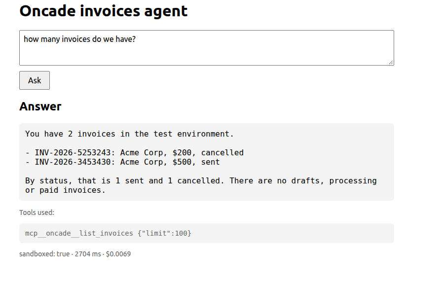

# Oncade invoices POC

A small TypeScript integration against the Oncade **test** environment (dev.oncade.xyz), built with
AI. It covers one flow end to end: **invoices**, including webhooks.



- **One screen.** Log in, ask a question in plain English ("Create a draft invoice for Acme, 10
  hours at $50", "Show my last 5 invoices"), get one answer plus the list of API tools the agent
  called.
- **Webhooks.** `POST /webhooks/oncade` verifies `x-oncade-signature` (HMAC-SHA256 of the raw body)
  and appends the event to `data/webhooks.jsonl`. The agent can read recent events back to confirm
  that something went through.
- **MCP tools.** The invoice actions are an MCP server, so the same tools work from this app's
  agent or from any MCP client (Claude Code, Codex, ...): `get_platform`,
  `get_business_readiness`, `list_invoices`, `get_invoice`, `create_draft_invoice`,
  `send_invoice`, `cancel_invoice`, `request_invoice_access`, `recent_webhooks`.
- **Sandbox.** The agent is Claude Code in headless mode with every built-in tool turned off and
  only the Oncade MCP server attached. On Linux it runs inside bubblewrap: read-only system and
  code, private `/tmp`, an empty `$HOME`, a cleared environment.

## Architecture

```
 browser ──► Fastify app (apps/server)          Oncade (dev.oncade.xyz)
             │  /login, /ask                      ▲            │
             │                                    │ REST       │ webhooks
             ▼                                    │            ▼
     run-agent.ts ── bwrap ──► claude -p          │     ngrok ──► POST /webhooks/oncade
     (apps/agent)              │ (no built-in     │                 │ verify HMAC
                               │  tools)          │                 ▼
                               ▼ stdio            │          data/webhooks.jsonl
                       Oncade MCP server ─────────┘                 ▲
                       (apps/mcp)  uses packages/oncade-client      │
                               └──── recent_webhooks ───────────────┘
```

| Path | What it is |
| --- | --- |
| `packages/oncade-client` | Typed Platform API client (test keys only) and the webhook verifier |
| `apps/mcp` | Invoice tools as an MCP stdio server |
| `apps/agent` | Runs one agent turn (`pnpm ask`), system prompt in `prompts/system.md` |
| `apps/server` | Login, the ask page, the webhook receiver |
| `AGENTS.md`, `CLAUDE.md`, `memory/` | The AI setup used to build this repo |

## Run it

Requirements: Node 24+, pnpm 9, Claude Code CLI (`claude`), optionally `bwrap` (Linux) and `ngrok`.

```bash
pnpm install
cp .env.example .env          # then fill in ONCADE_API_KEY and ONCADE_BUSINESS_ID
pnpm dev                      # http://127.0.0.1:3000, log in with admin / admin
```

- **Oncade key:** a test platform key from dev.oncade.xyz (Platforms -> API Keys). The client
  refuses anything that is not `oncade_platform_test_...`.
- **LLM:** by default the agent uses your logged-in Claude Code (`claude` once, then log in). To
  use an API key instead, set `ANTHROPIC_API_KEY` in `.env`. Model: `AGENT_MODEL` (default `sonnet`).
- **Sandbox:** `AGENT_SANDBOX=auto` (use bwrap if installed), `on` (require it), `off`.
- **Terminal only:** `pnpm ask "Show my platform info and my last 5 invoices"`.

### Webhooks

```bash
pnpm tunnel                   # ngrok http 3000
```

In dev.oncade.xyz, Platform Settings: set the webhook URL to
`https://<your-ngrok-host>/webhooks/oncade`, copy the webhook secret into `ONCADE_WEBHOOK_SECRET`
in `.env`, restart `pnpm dev`. Events land in `data/webhooks.jsonl`; a bad signature gets 401.

## Tests

```bash
pnpm test         # vitest: webhook signature verification, including malformed signatures
pnpm typecheck    # tsc --noEmit
```

## Current status

- The agent turn works inside bwrap and without it; login, the ask page and the webhook receiver
  were checked with curl.
- Verified end-to-end run: one prompt created two draft invoices ($500 and $200), sent the first
  without email, cancelled the second and listed the invoices. 7 tool calls, sandboxed, about
  $0.03 on Sonnet. The server received 4 signed webhooks (`Platform.Invoice.Created` x2,
  `Platform.Invoice.Sent`, `Platform.Invoice.Cancelled`) and rejected none.
- Invoice calls first returned **403 `SCOPE_NOT_GRANTED`**: the owner grant Oncade created had only
  `vc:*` scopes. They work after a business admin approved a link session for the invoice scopes.
  When the scopes are missing, the agent explains the error and calls `request_invoice_access`,
  which returns that approval link.

## How AI was used

The AI setup is in this repo: `AGENTS.md` holds the rules for any coding agent (commands,
MUST/SHOULD directives, verification and secrets rules), `CLAUDE.md` points to it, and `memory/`
keeps the project brief, the patterns and the current state.

**Tools used:**

- Claude Code (Opus): the main coding and research agent.
- Codex (a different model family): independent reviewer and fact-checker in the research phase.
- Claude Code CLI in headless mode (`claude -p`, Sonnet): the runtime of the in-app agent.
- Perplexity: research leads only; nothing from it was used without checking the source.

**Workflow:** one agent writes. Background subagents take implementation chunks, so the main
session stays on decisions. Every claim is checked against a primary source (the Oncade docs, the
API reference, an actual API response) or a run. A different model reviews independently. Nothing
counts as done until it has been re-run.

**Where it saved time:**

- Reading and cross-checking the Oncade docs and API reference.
- Scaffolding the client, the MCP tools, the server and the tests.
- Debugging the sandbox: a subagent found that DNS failed inside bubblewrap because
  `/etc/resolv.conf` is a symlink into `/run`, and fixed it.

**Where it got things wrong:**

- A research agent guessed a documentation URL and reported a broken page (404) that did not
  exist on Oncade's site. The independent Codex check caught it.
- The first sandboxed agent run hung silently and ended with "no result event". The cause was DNS
  inside bwrap (above). The symlink's target is now bound read-only, and the runner now reports
  the child's stderr when no result arrives.
- An early dependency pin pointed at an SDK version that does not exist and had to be redone.
- Not a mistake, but worth noting: when the shell swallowed "$50" from a prompt, the in-app agent
  did not invent an amount and asked for the real rate instead. That is the behaviour its system
  prompt asks for (`apps/agent/prompts/system.md`).

**Oncade issues found while building:**

- The owner grant was created with only `vc:*` scopes, so invoice calls returned
  `SCOPE_NOT_GRANTED` until a link session for the invoice scopes was approved.
- New API keys start with no scopes.
- The sample webhook verifier in the game docs throws on a malformed signature (Node's
  `timingSafeEqual` rejects buffers of different lengths), which turns a bad header into a 500
  instead of a 401. The verifier here checks the format first and never throws; a regression test
  covers it (`packages/oncade-client/src/webhook.test.ts`).
